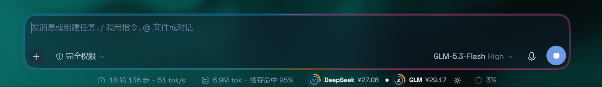

# Siri Apple Intelligence Light ✨

一个 **DeepSeek Harness (DSH)** 的 UI 插件:发送消息(点发送按钮或按 Enter)时,一条 **Siri / Apple Intelligence 同款光带**沿输入框边框循环奔跑 —— 彩色光晕打底,白色彗星领跑,只有边框亮,输入框内部保持干净。


## 实际效果

发送消息瞬间的输入框跑马灯:



## 效果

| 项目 | 说明 |
|---|---|
| 触发 | 点击发送按钮,或在输入框内按 Enter |
| 光带 | 彩色 conic 渐变(蓝→紫→粉→橙)贴边奔跑两圈,白色彗星领跑 |
| 范围 | 仅输入框卡片边框;圆角自动贴合输入框实际圆角;不扩散、不填光 |
| 按钮 | 发送按钮自身脉冲一次 |

无需任何开关 —— 装好即生效。

其他细节:

- 自动适配亮 / 暗主题
- 系统开启"减少动态效果"(`prefers-reduced-motion`)时自动禁用特效
- 特效层 portal 到 `document.body`,不干扰页面布局与交互

## 环境要求

- [DeepSeek Harness](https://github.com/) 桌面端 / Web GUI(支持 Cordis 插件体系的版本)
- 无需额外依赖:React 由 DSH Client 模块表提供,插件零安装依赖

## 安装（一条安装源即可，无需克隆）

在 DeepSeek Harness 的会话里，直接对 AI 助手说：

> 请把安装源 `github:hkd-Duo/Siri-Apple-Intelligence-Light` 安装为插件

助手会把该 GitHub 源加进当前 profile 并启用插件，返回 `application: applied` 即生效。然后 **刷新 GUI 页面**（Ctrl+R），让页面加载新的 Client 模块。

也可以在 DSH 的 **Plugins（插件）页** 里，用「从安装源安装」输入同一条源地址：`github:hkd-Duo/Siri-Apple-Intelligence-Light`

卸载：插件页移除，或在会话中让助手执行 `remove_bundle`。更新：重新安装同一安装源即可拿到最新版。

## 使用

发送消息（点发送按钮或按 Enter）→ 一条 Siri 风格光带沿输入框边框循环奔跑两圈，白色彗星领跑，输入框内部保持干净。

## 自定义

所有视觉效果集中在 `client.js` 的 `CSS_TEXT` 常量里，常用调整点：

| 想改什么 | 位置 |
|---|---|
| 配色 | `.aigw-edge-glow` 与 `.aigw-edge-comet` 的 `conic-gradient` 色标 |
| 光带粗细 | 两层的 `padding`（当前 3.5px / 1.5px） |
| 柔和度 | `.aigw-edge-glow` 的 `filter: blur(9px) saturate(1.15)` |
| 亮度 | `@keyframes aigw-edge-fade` 的峰值 opacity |
| 时长 / 圈数 | `aigw-sweep` 的时长与 `--aigw-angle` 终值（当前 180deg→900deg = 两圈） |
| 发送按钮识别 | 顶部 `SEND_LABEL_RE` 正则（若你的界面语言不含在已支持列表里） |

改完保存后刷新页面即可生效（本地目录链接安装时无需重装；从安装源安装则重新安装一次）。

## 故障排查

| 现象 | 处理 |
|---|---|
| 发送后无任何效果 | 先刷新页面；确认插件页里插件已启用；系统若开启"减少动态效果"会自动禁用特效 |
| 光带位置偏移输入框 | 已修复：光带会逐帧跟随输入框卡片高度变化。若仍异常，确认用的是最新版本 |
| 部分语言界面不触发 | `client.js` 顶部 `SEND_LABEL_RE` 加入对应语言的按钮文案（如 `senden`、`envoyer`），回车发送不受影响 |
| 想完全卸载 | DSH 插件页移除，或在会话中让助手 `remove_bundle` |

## 文件结构

```
Siri-Apple-Intelligence-Light/
├── package.json        # DSH 插件清单(dsh.client / dsh.bundle.patch 声明)
├── cordis.patch.yml    # Loader patch:插入插件条目
├── index.js            # Host 半(本插件无需 Host 逻辑)
├── client.js           # Client 半:全部光效逻辑
├── locale/en.json      # 英文标题与描述
├── locale/zh.json      # 中文标题与描述
├── icon.svg            # 插件图标
├── demo.html           # 可单独打开的本地演示页
└── docs/screenshot.png # README 效果截图
```

## 技术说明

- 注册槽位:`conversation.input.overlay`(特效锚点)
- 触发判定:捕获阶段监听 composer 区域内语义匹配的发送按钮点击 + 无修饰 Enter 键;特效层通过 portal 挂到 `document.body`

## License

MIT
